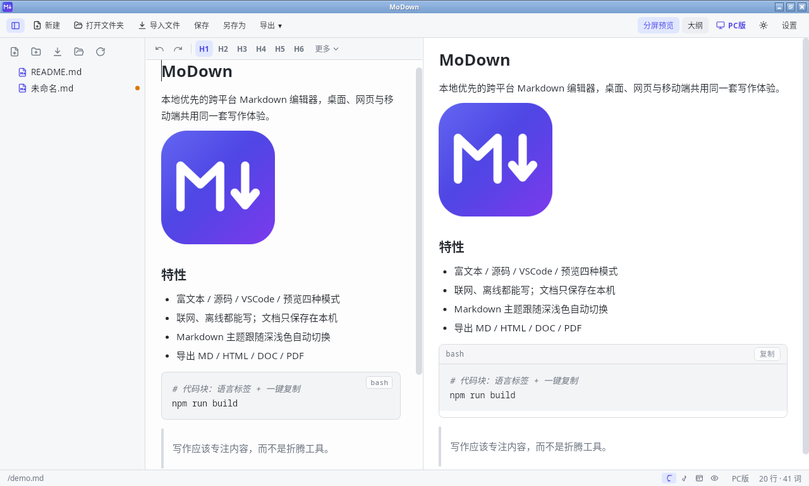
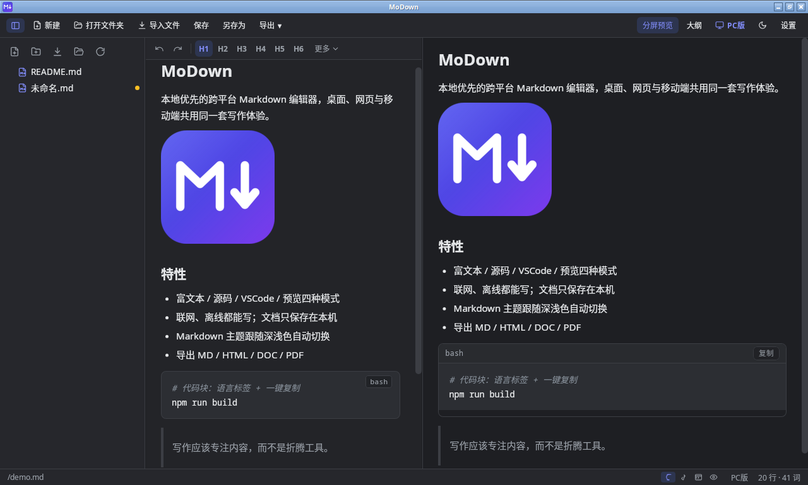
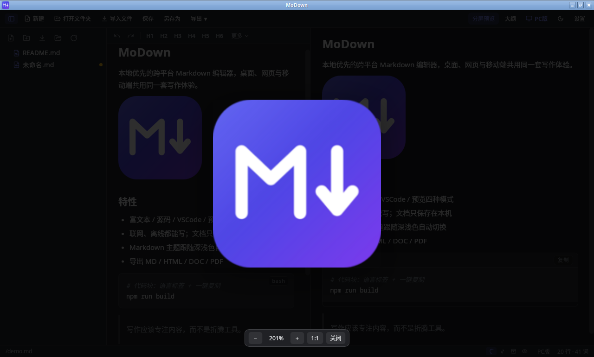
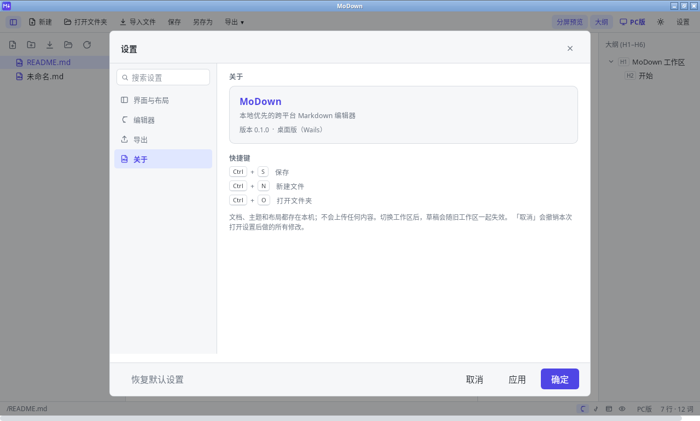
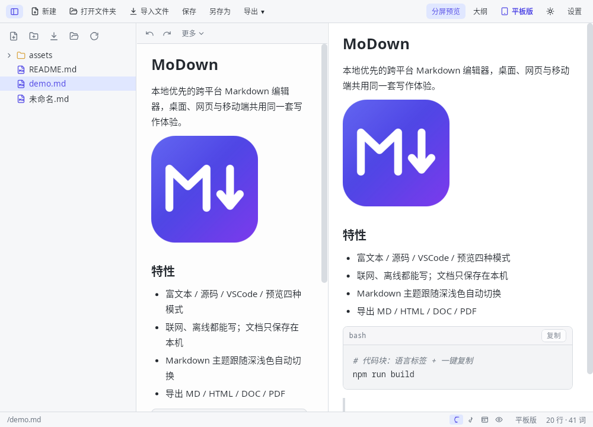
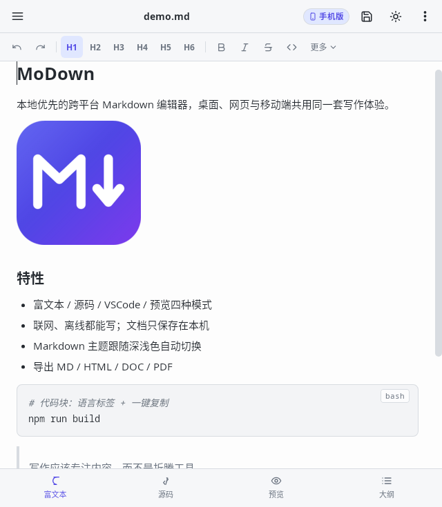

# MoDown · 跨平台 Markdown 编辑器

本地优先（local-first）的 Markdown 编辑器，**同一套前端代码**跑在 PC 与移动端：
桌面端偏写作与文档管理，移动端偏随时记录、浏览和轻编辑。

> 编译 / 配置 / 验证命令请直接看 **[AGENTS.md](AGENTS.md)**（含 PC、手机、macOS、Linux 全部构建方式）。
> 需求与界面设计见 **[方案.md](方案.md)**。

## 截图

<table>
  <tr>
    <td></td>
    <td></td>
  </tr>
  <tr>
    <td align="center">桌面端 · 浅色（分屏编辑 / 72ch 预览）</td>
    <td align="center">桌面端 · 深色（主题自动适配）</td>
  </tr>
  <tr>
    <td></td>
    <td></td>
  </tr>
  <tr>
    <td align="center">预览图片查看器（缩放 / 拖拽）</td>
    <td align="center">设置 · 关于</td>
  </tr>
</table>

<p align="center">
  
  
  <br>
  平板 / 手机（Android、HarmonyOS、网页端同一套界面）
</p>

## 功能

- Markdown 实时编辑与预览：富文本（Tiptap）/ 源码（CodeMirror 6）/ VSCode 网页版（Monaco，**默认开启**）三种编辑器可切换
- 富文本工具栏按钮按组自动折叠：宽度不够时收进尾部「更多 ▾」，点开换行全显（不用手动隐藏按钮）
- 文件树：新建文件/文件夹（VSCode 式内联输入）、重命名、删除、折叠展开、右键 / 长按菜单
- 本地文件读写；导入文件 / 打开文件**保留原始后缀**（ini、yaml、java、py、go、bat…），只有新建文档才补 `.md`
- 导入图片复制到工作区，视频音频等只保存链接
- 导出 MD / HTML / DOC / PDF（DOC/PDF 走 Pandoc 或系统打印）；**用户取消保存位置对话框时不误报「导出成功」**
- H1–H6 大纲栏、分屏（左编辑右预览）、主题（跟随系统 / 浅色 / 深色）
- 移动端：编辑 / 大纲 / 预览三模式、文件树抽屉、底部弹窗大纲、手势缩放；长按文件弹菜单；「打开文件夹」＝切换工作区根目录
- 移动端 / 浏览器等无原生对话框的环境，用应用内选择器选目录与保存位置（`PathPickDialog`）
- 界面模式在**编译期**固定：PC 版永远是 PC 界面，移动端版可选手机/平板并随窗口尺寸自适应

## 目录结构

```text
d:/MoDown
├─ frontend/                  前端唯一真源（Vue 3 + Vite + TypeScript + Pinia）
│  ├─ src/bridge/             PlatformBridge：wails / capacitor-android / harmony / mock
│  ├─ src/components/         TopBar、FileTree、TreeItem、Editor、RichEditor、CodeEditor、
│  │                          MonacoEditor、Preview、OutlinePane、SettingsDialog、DialogHost…
│  ├─ src/stores/workspace.ts 工作区、文件、设置、导出等全部状态
│  ├─ src/utils/              device.ts（平台判定）、exporter.ts（导出）、outline.ts、shortcuts.ts…
│  ├─ src/styles/global.css   全局样式（顶栏、文件树、编辑器、移动端等）
│  └─ dist/                   vite 构建产物（构建时复制到 desktop/frontend/dist 并打包成 web.zip）
├─ desktop/                   Go + Wails v2 桌面壳（Windows / macOS / Linux）
│  ├─ main.go                 窗口配置 + AssetServer（/assets、/files 映射工作区）
│  ├─ app.go                  全部后端 API：文件读写、导入、导出 PDF/DOCX、设置读写
│  ├─ webassets.go            内嵌 web.zip，首次运行解压到用户缓存（exe 从 26MB 降到 15MB 的关键）
│  ├─ tools/packweb/          把前端产物打成 web.zip 的小工具（go run）
│  ├─ copy-frontend.ps1       构建前端 → 拷进 desktop/frontend/dist → 打包 web.zip（Wails 钩子调用）
│  ├─ build/bin/MoDown.exe 构建产物
│  └─ wails.json              exe 名称与前端构建钩子
├─ mobile/                    移动端壳工程（Capacitor + 鸿蒙 ArkWeb）
│  ├─ capacitor.config.ts     appId / webDir=www / androidScheme=https
│  ├─ build-apk.ps1           一键出 APK：vite(mobile) → cap sync → gradlew assembleRelease
│  ├─ build-hap.ps1           一键出 HAP：vite(mobile) → 同步 rawfile → hvigor assembleHap（需鸿蒙工具链）
│  ├─ www/                    mobile 前端产物（安卓/鸿蒙共用，自动生成，不覆盖 frontend/dist）
│  ├─ Android/                Gradle 壳工程（keystore 签名 + 腾讯云/阿里云镜像配置）
│  ├─ HarmonyOS/              鸿蒙 ArkWeb 壳工程（手写 hvigor/ArkTS，$rawfile 加载前端 + window.nativeHarmony 原生桥）
│  ├─ apk/MoDown-release.apk    安卓构建产物（签名）
│  └─ hap/*.hap                    鸿蒙构建产物（本机首包为未签名）
├─ tools/                     调试杂物：截图脚本、WebView2 安装包、pandoc.zip、临时 html
├─ 方案.md                    需求 / 界面设计 / 各平台方案
├─ AGENTS.md                  编译、配置、验证速查（AI 与开发者都从这里开始）
└─ README.md                  本文件
```

## 快速开始

Windows PC 版构建（前置：Go ≥ 1.25、Node 22、Wails CLI v2.16、WebView2 Runtime）：

```powershell
Get-Process MoDown -ErrorAction SilentlyContinue | Stop-Process -Force
powershell -NoProfile -ExecutionPolicy Bypass -File d:\MoDown\desktop\copy-frontend.ps1
cd d:\MoDown\desktop
wails build -platform windows/amd64
# 产物：d:\MoDown\desktop\build\bin\MoDown.exe
```

> `wails build` 生成绑定这一步会先编译一次 Go，而 `//go:embed web.zip`（内嵌的前端压缩包）缺失时会直接报错，
> 所以**首次构建、或手动清空过 `desktop/web.zip` 时，要先跑 `copy-frontend.ps1` 把产物补上**（详见 [AGENTS.md](AGENTS.md) 3.1）。

只调前端（浏览器里跑，自动使用 mock 桥）：

```powershell
cd d:\MoDown\frontend
npm run dev          # http://localhost:5173
```

Android APK（手机/平板界面 + 原生壳）：

```powershell
powershell -NoProfile -ExecutionPolicy Bypass -File d:\MoDown\mobile\build-apk.ps1
# 产物：d:\MoDown\mobile\apk\MoDown-release.apk
```

脚本依次做：`vite build --mode mobile` → `mobile/www`（不覆盖 PC 的 `frontend/dist`）→ `npx cap sync android`
→ `gradlew assembleRelease` → 收产物并校验签名。工具链要求（JDK 21 / Android SDK 36 / Gradle 8.14.3）与镜像配置见 `AGENTS.md` 第 2、3.6 节。

鸿蒙 HAP（壳工程与原生桥已入库；本机 DevEco Studio 26 工具链已验证可出未签名包，装真机前需在自己的
DevEco 里勾 Auto signing 重出签名包）：

```powershell
cd d:\MoDown\mobile
npm run harmony:sync   # 构建前端并同步进壳的 rawfile，之后在 DevEco Studio 里打开工程 Run（Auto signing）
npm run harmony        # 全流程出 HAP：需鸿蒙工具链 + 华为开发者证书，详见 AGENTS.md 3.7
```

与安卓的差异（本地工作区为真实落盘沙箱目录、不支持系统目录工作区、PDF 走系统打印界面）见 `AGENTS.md` 3.7。

只想看手机界面：`cd frontend; npm run dev`，浏览器设备工具栏调到 430×880 即可。

## 云编译（GitHub Actions）

工作流文件：`.github/workflows/build.yml`。推送 `main`、打 `v*` 标签，或在 Actions 页面手动 `workflow_dispatch` 即可触发。

| Job | Runner | 产物 |
| --- | --- | --- |
| Android（minSdk 24 = Android 7.0+） | `ubuntu-latest` + JDK 21 + Android SDK 36 | `MoDown-android7-debug.apk` |
| Windows x64 | `windows-latest` + Go + Node + Wails v2.16 | `MoDown-windows-x64.exe` |
| Linux x64（Ubuntu 20.04+） | `ubuntu:20.04` 容器（glibc 2.31 + WebKitGTK 4.0） | `MoDown-linux-x64-ubuntu20.04.tar.gz` |
| 网页端 | `ubuntu-latest` + Node 22 | `MoDown-web.zip`（静态站点） |

说明：

- Android 默认产出 **debug 签名** APK，可直接安装测试；正式发版时在仓库 Secrets 配好 keystore 后把 `assembleDebug` 换成 `assembleRelease`。
- Linux 使用 `ubuntu:20.04` 容器编译，链接 20.04 的 glibc/WebKitGTK，因此可在 Ubuntu 20.04 及以上运行。
- 所有产物在对应 Actions 运行页面的 **Artifacts** 区域下载，保留 14 天。

## 体积与启动

PC 版 exe 约 **15.3MB**（此前内嵌未压缩前端资源时是 26MB）：

- 前端产物 15MB（其中 Monaco 的 ts/css/html/json 语言 worker 占 13MB），压成 `web.zip`（约 3.8MB）后才内嵌进 exe
- 运行时解压到 `%LOCALAPPDATA%\MoDown\web-<内容哈希>\` 并跨次启动复用：首次约 0.76s 出窗口，之后约 0.38s
- 缓存目录不可写时自动退到 `%TEMP%\MoDown\`，不影响启动
- Monaco / CodeMirror 仍是懒加载，切到对应编辑器才加载

## 平台方案一览

| 平台 | 宿主 / 壳 | 状态 |
| --- | --- | --- |
| Windows 10/11 | Go + Wails v2（WebView2） | 已实现，当前主力 |
| macOS / Linux | Go + Wails v2 | 代码已兼容（`*_other.go` 空实现）；Linux 由 GitHub Actions 用 Ubuntu 20.04 容器构建 |
| Android 7+ | Capacitor 8 WebView 壳（`mobile/Android`，`gradlew` 出 APK） | 壳工程已入库，GitHub Actions 可出可安装 APK；原生文件读写仍是 mock 桥（Phase 3） |
| HarmonyOS NEXT（5+） | 纯 ArkWeb 壳（`mobile/HarmonyOS`，`hvigorw` 出 HAP） | 壳工程 + `window.nativeHarmony` 原生桥已入库；本机工具链已验证产出未签名 HAP，真机安装需华为签名证书（AGENTS.md 3.7） |
| Win7 / Win8 | Go 1.20 + Wails v2 + WebView2 109 | 规划中的兼容线 |
| 任意 WebView 宿主 | 纯静态 `frontend/dist`（`base: './'`） | 只需实现一个 PlatformBridge |
